<picture>
  <source media="(prefers-reduced-motion: reduce)" srcset="assets/hero-static.svg" />
  
</picture>

 

<a href="https://xand0dev.github.io/"></a>

<a href="https://xand0dev.github.io/"><b>xand0dev.github.io</b></a> · <a href="https://xand0dev.github.io/atlas">Atlas: SDD and human–agent teams</a> · <a href="https://xand0dev.github.io/certificates">Certificates</a>

<a href="https://xand0dev.github.io/mars404/"></a>

<a href="https://xand0dev.github.io/mars404/">Live demo</a> · <a href="https://github.com/xand0dev/mars404">Source</a> · <a href="https://www.spaceappschallenge.org/2026/find-a-team/mars404/?tab=project">Space Apps project</a>

  <a href="mailto:oleksandr.riasnyi.dev@gmail.com?subject=SkillForge%20demo"></a>
  <a href="https://github.com/xand0dev/FITGYM-demo"></a>
  <a href="mailto:oleksandr.riasnyi.dev@gmail.com?subject=LeadForge%20demo"></a>
  <a href="mailto:oleksandr.riasnyi.dev@gmail.com?subject=CogniTrace%20demo"></a>

  <a href="https://github.com/xand0dev/VoidBar"></a>
  <a href="https://github.com/xand0dev/eden-zero"></a>
  <a href="https://github.com/xand0dev/TraceFlow"></a>
  <a href="https://github.com/xand0dev/zerotokens-skill"></a>
  <a href="https://github.com/xand0dev/django-saas-toolkit"></a>
  <a href="https://github.com/xand0dev/ascii-render"></a>
  <a href="https://github.com/xand0dev/ai-pool-starter"></a>


<a href="https://github.com/xand0dev?tab=overview"></a>

  

  
  &nbsp;
  
  &nbsp;
  

